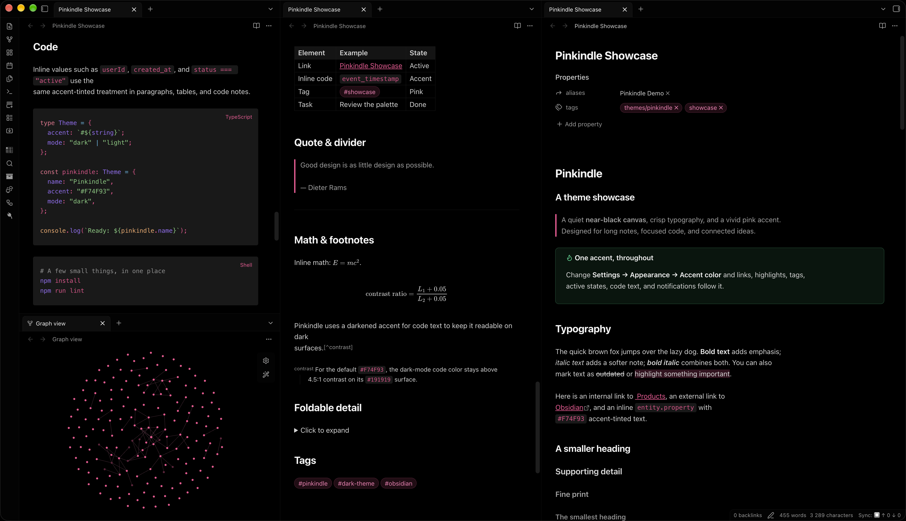

# Pinkindle

A near-black Obsidian theme with a hot-pink accent, crisp typography, and
subtle surfaces for focused writing and code.



## Design

| Token | Dark | Light |
| --- | --- | --- |
| Canvas | `#000000` | `#fcfcfc` |
| Surface | `#0e0e0e` | `#ffffff` |
| Raised | `#141414` | `#fcfcfc` |
| Border | `#191919` | `#e4e4e7` |
| Ink | `#d4d4d4` | `#27272a` |
| Muted ink | `#9a9a9a` | `#71717b` |
| Accent | `#f74f93` | `#f74f93` |

- System UI font stack (SF Pro / Inter / Segoe UI), Menlo / SF Mono for code.
- 8px base radius (`0.5rem`), pill-shaped tags.
- Pink is used for links, carets, checkboxes, tab indicators, and selection;
  light-mode links derive a darker shade (`#c9186c` from the default accent)
  to keep 4.5:1 contrast.
- The accent is fully driven by Obsidian's **Settings → Appearance → Accent
  color** (`--accent-h/s/l`). The theme ships with `#f74f93` as its default,
  so the picker starts on that exact pink — change it and every accent token
  (links, buttons, tags, callouts, selection, graph, canvas) follows.
- Notification toasts reuse the sidebar-selection recipe (16% accent over the
  sidebar surface), so they read as part of the theme instead of dark grey.
- Code text — inline chips and fenced blocks — is a shade of the accent
  (deepened in dark mode, darkened further in light mode for contrast), so it
  repaints when you change the accent color. Syntax token colors stay as-is.
- Syntax colors distinguish keywords, strings, values, operators, and functions.

## Install

1. Copy this folder to `<vault>/.obsidian/themes/Pinkindle`.
2. In Obsidian, open **Settings → Appearance → Themes** and select **Pinkindle**.

Or, for development, symlink the repo into your vault:

```sh
ln -s "$PWD" "<vault>/.obsidian/themes/Pinkindle"
```

## Develop

All styles live in `theme.css`. Lint with the same config Obsidian uses for
theme review:

```sh
npm install
npm run lint
```

## Release

Bump the version and push a matching tag; the included workflow creates a draft
release with `manifest.json` and `theme.css` attached.

```sh
npm version patch
git push --follow-tags
```

## License

MIT
